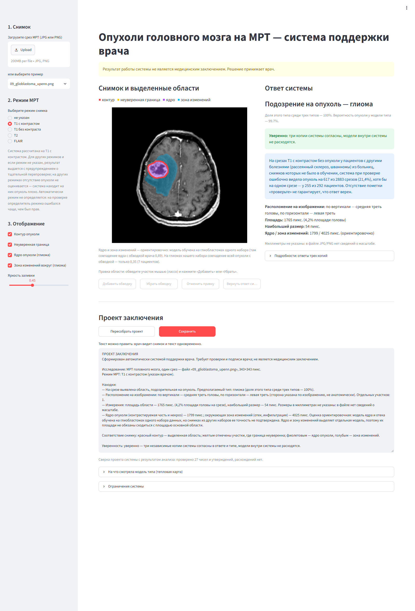

# ИИ-обнаружение и локализация опухолей головного мозга на МРТ

Система поддержки врача. По одному срезу МРТ головного мозга (основной режим — T1 с контрастом) она:

- определяет, есть ли опухоль и какая — глиома, менингиома или опухоль гипофиза;
- обводит опухоль на снимке и отмечает участки, где граница неуверенна;
- у глиомы отдельно выделяет ядро опухоли и окружающую зону изменений (отек);
- ставит пометку «проверьте», когда не уверена, и объясняет почему;
- готовит проект заключения, который врач правит вместе с выделенными областями и сохраняет.

Это помощник врача, а не медицинское заключение.

Версия финала чемпионата. Версия полуфинала — https://github.com/McJija/CaseChamp.Semifinal.

## Как запустить

**Windows 10/11**

1. Скачайте проект: зеленая кнопка **Code → Download ZIP** вверху страницы. Архив весит около 0,7 ГБ: в нем веса моделей. Распакуйте его недалеко от корня диска, например в «Загрузки» или в `C:\mri`. Windows не открывает файлы с путем длиннее 260 символов.
2. В распакованной папке дважды щелкните **`start_windows.bat`**.
3. Когда все будет готово, сам откроется браузер с прототипом. Выберите пример в панели слева или загрузите свой снимок (JPG или PNG) и укажите режим МРТ.

**Сколько ждать.**
- Первый запуск занимает 5–10 минут и требует интернета: скрипт сам скачивает Python 3.10 и библиотеки.
- Следующие запуски — 20–30 секунд, интернет не нужен.
- После запуска модели загружаются еще около 30 секунд.

**Если Windows ругается.** Окно «Система Windows защитила ваш компьютер»: нажмите «Подробнее» → «Выполнить в любом случае». Скрипт не подписан цифровой подписью. Чтобы остановить прототип, закройте черное окно.

**macOS (Apple Silicon) и Linux**

- macOS: дважды щелкните **`start_mac.command`**. Если macOS не дает его открыть, щелкните правой кнопкой → «Открыть». Можно и из Терминала: `bash start_mac_linux.sh`.
- Linux: `bash start_mac_linux.sh`.

Mac с процессором Intel не поддерживается: для него нет сборок PyTorch нужной версии. Запуск проверен на Windows 11. Скрипт для macOS и Linux устроен так же, но на этих системах не проверялся.

**Что ставится и куда.** В систему ничего не ставится: Python, библиотеки и кэш загрузок остаются внутри папки проекта (`.tools/` и `.venv-app/`). Уже установленный Python не используется и не меняется. Чтобы удалить все, удалите папку.

**Какой нужен компьютер.** Видеокарта не нужна. На обычном процессоре снимок обрабатывается примерно за 1 секунду, с тепловой картой — за 1,7 секунды. Памяти нужно около 1,5 ГБ.

**Вручную** (если Python 3.10 уже установлен):

```bash
python -m venv .venv-app
.venv-app/Scripts/python -m pip install torch==2.14.1 torchvision==0.29.1 --index-url https://download.pytorch.org/whl/cpu
.venv-app/Scripts/python -m pip install -r requirements-app.txt
.venv-app/Scripts/python app/launch.py          # macOS и Linux: .venv-app/bin/python
```

Без интерфейса, из командной строки: `python -m src.system снимок.jpg --mode t1c`.

## Что показывает прототип



1. **Снимок и режим МРТ.** Врач загружает срез и выбирает режим: T1 с контрастом, T1, T2 или FLAIR. Если режим не указан или это не T1 с контрастом, результат выдается с предупреждением о тщательной перепроверке. На T1, T2 и FLAIR система находит опухоль плохо, поэтому ответ «опухоли нет» на них не выдается как вывод: экран пишет, что на этом режиме отсутствие находки не оценивается. Автоматически режим не определяется: наш определитель режима на снимках из незнакомых больниц ошибался чаще, чем был прав.
2. **Выделенные области.** Поверх снимка:
   - красный контур — опухоль;
   - желтым — участки, которые выделили не все три копии системы (неуверенная граница);
   - у глиомы фиолетовым — ядро опухоли, голубым — зона изменений вокруг.
3. **Ответ и уверенность.** Тип опухоли или «признаков опухоли нет» (на режимах, отличных от T1 с контрастом, — «отсутствие находки не оценивается»); затем «уверенно» или «проверьте» с причиной, например «модель типа подозревает опухоль, а модель контура область не выделила». Рядом — измерения: площадь, доля площади головы, наибольший размер, расположение на изображении.
4. **Проект заключения.** Текст собирается по шаблону только из результатов анализа, без языковой модели: находки, расположение, измерения, уверенность, сомнения и ограничения. Каждое число и утверждение текста автоматически сверяется с результатом анализа. Если врач изменит текст, расхождения с анализом будут показаны.
5. **Правка и сохранение.** Врач обводит участок мышью и добавляет его к области или убирает из нее; правку можно отменить. Итог сохраняется в `data/annotations/` или скачивается архивом:
   - снимок;
   - области до и после правки;
   - текст системы и итоговый текст;
   - все в машиночитаемом виде (`результат.json`).
6. **Тепловая карта** (свернутый блок). Показывает, на что смотрела модель типа, а не где опухоль.

Примеры в `app/examples/` взяты из проверочной части данных, на которой модели не обучались:
- 01–08 — данные кейса и Figshare;
- 09 — глиобластома из набора UPENN-GBM;
- 10 и 11 — случаи, где пометка «проверьте» поймала ошибку системы.

Все экраны — в [reports/prototype/screenshots_final/](reports/prototype/screenshots_final/).

## Результаты: до и после доработки

«До» — версия полуфинала. «После» — версия финала: модели дообучены на снимках двух внешних наборов, UPENN-GBM (глиобластома) и BraTS-MEN-RT (менингиома).

**Как измеряли.**
- Все правила оценки записывались до замеров. Пороги в правилах — наша договоренность, а не клиническая норма.
- Отложенные снимки открывались по одному разу на каждую версию, по ним смотрели только сводные числа. Но версию финала выбирали, уже видя результаты всех версий, поэтому ее цифры слегка оптимистичны.
- Интервалы — бутстреп по пациентам.
- Полные таблицы — [reports/run4/candidates_compare.md](reports/run4/candidates_compare.md) и [reports/run3/before_after.md](reports/run3/before_after.md). Дополнительные разбивки — по пациентам, по среднему трех копий, по уровню среза — [reports/run3/review_numbers.md](reports/run3/review_numbers.md).

| Проверка | До | После |
| --- | --- | --- |
| **Ложная тревога на срезах T1 с контрастом без опухоли** у пациентов с другими болезнями — рассеянным склерозом (Любляна) и шванномой (Лондон, 90% срезов); снимков этих больниц не было в обучении. 292 пациента, 2883 среза | 26,1% | **21,4%** (−4,7 п.п. [−6,9; −2,7]) |
| То же, среднее трех копий системы (меньше зависит от удачи одной копии) | 25,3% | 22,3% (−3,0 п.п. [−4,8; −1,2]) |
| Пациентов хотя бы с одной ложной тревогой на этих срезах | 264 из 292 (90%) | 255 из 292 (87%) |
| Ложная тревога на новых пациентах больниц, чьи снимки были в обучении (UPENN-GBM / BraTS-MEN-RT) | 22,4% / 29,6% | **1,4% / 1,4%** |
| Найдено опухолей на нашей проверочной части (здесь подбирался порог) | 466 из 469 | 462 из 469 |
| Найдено опухолей на тесте полуфинала (уже просматривался при разборе ошибок) | 528 из 533 | 518 из 533 (−1,9 п.п. [−4,1; −0,2]; пропущенных глиом 1 → 9) |
| Найдено опухолей у отложенных пациентов UPENN-GBM / BraTS-MEN-RT | 92,6% / 83,8% | 98,5% / 77,5% |
| Тип опухоли верен среди найденных, тест полуфинала | 83,9% | 87,6% |
| Тип верен у менингиом новых пациентов BraTS-MEN-RT (больница из обучения) | 38,6% | **90,5%** |
| Совпадение контура с обводкой врача (Dice по пациентам: 0 — нет совпадения, 1 — полное): тест полуфинала / UPENN-GBM / BraTS-MEN-RT | 0,748 / 0,706 / 0,511 | 0,754 / **0,876** / 0,590 |
| Найдена незнакомая опухоль (шванномы, два экзамена) | 70% / 78% | 78% / 83% |

**Главное ограничение — ложные тревоги.**
- На срезах T1 с контрастом без опухоли у пациентов из больниц, снимков которых не было в обучении, система ошибочно видит опухоль примерно на каждом пятом срезе. Хотя бы на одном срезе — почти у каждого пациента: у 255 из 292.
- Поэтому система — помощник для обводки, измерений и проекта заключения на срезе, который выбрал врач. Это не поиск опухоли по всему исследованию.
- Ограничение показано на экране и в каждом заключении.

**Почему дообучение помогло мало.** На новых пациентах тех же больниц ложные тревоги почти исчезли (22–30% → 1,4%), на чужих — нет. Объяснений два, и мы их не разделили:
- **Незнакомая больница**: аппарат, протокол, обработка снимков. Проба показала, что набор узнается по резкости и шуму даже после единой подготовки снимков ([reports/source_probe_report.md](reports/source_probe_report.md)). Выравнивание резкости (версия `run4`) это не исправило.
- **Уровень среза, которого не было в обучении.** Срезы внешних наборов у основания черепа мы в обучение не брали: там стертое ради обезличивания лицо. На экзаменах такие срезы есть. У шванном ложные тревоги рядом с опухолью, у основания черепа, — 34,6%, а дальше 60 мм, у верха головы, — 2,2%. У версии полуфинала — 32,5% и 19,2%. Эту разбивку мы сделали уже после просмотра результатов.

**Почему выбрана эта версия, хотя правило замены не выполнено.**
- Мы заранее требовали снизить ложные тревоги хотя бы на 20 п.п. Получилось 4,7 п.п. по основной копии и 3,0 — по среднему трех копий. По правилу должна была остаться версия полуфинала.
- Новая версия поставлена решением руководителя проекта вне правила и по другой причине: у нее работает пометка «проверьте» и точнее тип опухоли.
- Цена: на тесте полуфинала она находит 518 опухолей из 533 вместо 528. Все 15 пропусков при этом помечены «проверьте».
- Условие «пропусков не больше чем на 1 п.п. больше» на нашей проверочной части выполняется по построению: порог подбирался там же. Поэтому его выполнение ничего не доказывает.
- От версии `run4` (то же плюс выравнивание резкости) по ложным тревогам она не отличается: по среднему копий +0,3 п.п. [−0,6; +1,3]. Выбрана как более простая.

**Пометка «проверьте».** Она помогает находить ошибки, если одновременно:
- помечено не больше 25% снимков;
- поймано не меньше половины ошибок;
- среди помеченных ошибок хотя бы втрое больше, чем среди «уверенных».

| Набор | Помечено | Поймано ошибок | Помогает |
| --- | --- | --- | --- |
| Наша проверочная часть (здесь способ выбирался из 12 вариантов, поэтому цифры оптимистичны) | 9,5% снимков | 17 из 18 | да |
| Тест полуфинала | 13,1% | 44 из 80 (55%), в том числе все 15 пропусков | да |
| Отложенные пациенты UPENN-GBM и BraTS-MEN-RT | 12,3% | 38 из 76 (50%) — ровно на границе; у менингиом BraTS-MEN-RT отдельно 47% | да |
| Срезы без опухоли из незнакомых больниц | 46–50% | — | нет |

Итого: пометка ловит пропуски и ошибки типа на знакомых данных. Ложные тревоги на чужих срезах без опухоли она не отличает — помечает почти половину всех срезов. У версии полуфинала пометка не помогала ни на одном наборе.

**Ядро и отек при глиобластоме.**
- На 30 отложенных пациентах UPENN-GBM совпадение с обводкой врача: ядро 0,89, отек 0,64. С дополнительным режимом FLAIR отек был бы 0,78.
- На глиомах из данных кейса совпадение всей опухоли с обводкой — только 0,35 (7 пациентов). Поэтому на экране ядро и отек помечены как ориентировочные.

## Как устроено

```
снимок → подготовка (обрезка полей, 256×256, выравнивание яркости)
       → три копии системы (обучены с разными seed), в каждой:
           модель типа (ResNet34): тип опухоли и вероятность
           модель контура (U-Net, ResNet34): обводка опухоли
       → ответ основной копии: «опухоль есть», если обведено больше 50 пикселей
           или вероятность опухоли у модели типа не ниже 0,989
       → «проверьте», если копии расходятся в ответе или типе, если внутри системы
           расходятся модели, или если тип неуверенный (доля самого вероятного < 60%)
       → неуверенная граница: пиксели, которые выделили одна или две копии из трех
       → для глиомы — модель ядра и отека (U-Net), обучена на UPENN-GBM
       → проект заключения по шаблону и его автоматическая сверка с результатом
```

Код системы — `src/system.py`, заключение — `src/conclusion.py`, экран — `app/app.py`. Порог и способ пометки «проверьте» подбирались только на проверочной части: `configs/presence_run3.yaml`, `configs/confidence_run3.yaml`. Состав системы — `configs/system_run3.yaml`.

Главное в работе — данные, а не архитектура:

- **Утечка в исходном делении.** У 72,9% тестовых снимков организаторов есть копия в обучающей части. Мы заново поделили все снимки по пациентам ([reports/leakage_report.md](reports/leakage_report.md), [reports/splits_report.md](reports/splits_report.md)).
- **Маски.** Обводок опухолей в данных кейса нет. Большая часть снимков совпала с открытым набором Figshare, где опухоли обвели врачи ([reports/figshare_match_report.md](reports/figshare_match_report.md)). Как размечать маски без готового набора — [docs/models.md](docs/models.md#если-бы-готовых-масок-не-нашлось).
- **«Короткий путь».** Снимки «без опухоли» в данных кейса сняты в других режимах и в других больницах, чем снимки с опухолями. Здоровых снимков T1 с контрастом почти нет: контраст вводят по показаниям, в основном при подозрении на опухоль. Модели учатся узнавать вид снимка вместо опухоли. Мы это проверяли:
  - тест с закрашиванием опухоли;
  - стресс-тест;
  - проверка на срезах без опухоли из независимых больниц.

  Для борьбы добавили срезы без опухоли из внешних наборов. На тех же больницах это почти убрало ложные тревоги, на незнакомых помогло мало — см. «Почему дообучение помогло мало».
- **Честная оценка.** Правила выбора моделей, порогов и замены версии записывались до замеров, с доказательством в истории изменений. Решающие сравнения — на трех seed. Отложенные проверки открывались один раз на каждую версию. Версия финала выбрана после этого и вне записанного правила (см. выше).

Подробнее о работе до полуфинала:
- подготовка данных — [docs/data.md](docs/data.md);
- модели и рассмотренные подходы — [docs/models.md](docs/models.md);
- разбор ошибок с врачом — [docs/errors.md](docs/errors.md);
- внедрение, защита данных, регистрация и затраты — [docs/practical_use.md](docs/practical_use.md).

## Данные

| Набор | Для чего | Лицензия | Распространяем |
| --- | --- | --- | --- |
| Данные кейса (организаторы) + Figshare (Cheng et al.) | обучение, проверка, тест | организаторы / CC BY 4.0 | да, в [Releases версии полуфинала](https://github.com/McJija/CaseChamp.Semifinal/releases): `brain_mri_dataset.zip`, `brain_mri_cache256.zip` |
| UPENN-GBM (глиобластома) | обучение моделей типа, контура, ядра и отека | CC BY 4.0 | нет, скачивается скриптом |
| BraTS-MEN-RT (менингиома) | обучение моделей типа и контура | CC BY-NC 4.0 | нет, только с учетной записью Synapse |
| Рассеянный склероз (Любляна) | только проверка: срезы без опухоли | CC BY | нет, скачивается скриптом |
| Vestibular-Schwannoma-SEG и -MC-RC (Лондон) | только проверка: срезы без опухоли и «незнакомая опухоль» | CC BY 4.0 | нет, скачивается скриптом |

Деление пациентов внешних наборов на обучение, проверку и отложенную часть — `data/processed/external_split.csv`.

Таблицы отбора снимков кейса — в `data/processed/`:
- `pool.csv` — итоговый набор;
- `splits.csv` — судьба каждого из 12 064 файлов организаторов;
- `folds_frozen.csv` — замороженное деление пациентов;
- `review_decisions.csv` — ручная проверка класса «нет опухоли»;
- `label_fixes.csv` — исправленные метки.

Веса моделей обучены в том числе на данных BraTS-MEN-RT с лицензией CC BY-NC, поэтому используйте их только в некоммерческих целях.

## Как воспроизвести

Полное окружение: Python 3.10, `pip install -r requirements.txt`. Обучение шло на бесплатной видеокарте Kaggle, инструкция — [docs/kaggle.md](docs/kaggle.md).

Данные кейса и Figshare. Готовый набор — архивы из Releases версии полуфинала. Или собрать из исходных файлов
организаторов в папке `mrt/`:

```bash
python -m src.build_index            # опись 12 064 файлов: класс, часть, тип искажения по имени файла
python -m src.find_duplicates        # копии одного снимка по «отпечатку изображения»; утечка между частями
python -m src.download_figshare      # открытый набор Figshare с обводками опухолей
python -m src.convert_figshare       # .mat → PNG снимки и маски
python -m src.match_figshare         # совпадения со срезами Figshare: обводки и номера пациентов
python -m src.make_review_decisions  # правило отбора класса «нет опухоли» по ответам проверяющих
python -m src.make_splits            # деление по пациентам (по folds_frozen.csv) и все исключения
python -m src.build_cache            # подготовка снимков организаторов
python -m src.build_pool             # итоговый набор pool.csv и кэш pool_256
```

Внешние наборы, обучение и оценка версии финала:

```bash
python -m src.download_upenn_gbm --out data/external/upenn_gbm --extra T1w.nii.gz T2w.nii.gz
# BraTS-MEN-RT: архив с Synapse (syn53708249), файлы *_t1c.nii.gz и *_gtv.nii.gz пациентов
#   из external_split.csv положить в data/external/brats_men_rt/nifti/
python -m src.download_ms_ljubljana --out data/external/ms_ljubljana --extra T1W.nii.gz T2W.nii.gz FLAIR.nii.gz --xfm
python -m src.download_idc --preset vs_mc_rc --out data/external/vs_mc_rc
python -m src.download_idc --preset vs_seg --n-patients 40 --out data/external/vs_seg
python -m src.convert_vs
python -m src.build_external_slices   # срезы и кэш ext_256 по external_split.csv
python -m src.build_mode_slices       # срезы T1, T2, FLAIR тех же пациентов
python -m src.build_core_cache        # ядро и отек UPENN-GBM

# обучение (Kaggle): модели типа и контура на seed 42, 43, 44; ядро и отек — seed 42
python -m src.train --config configs/run3_cls.yaml --seed 42
python -m src.train --config configs/run3_seg.yaml --seed 42
python -m src.train_aux --config configs/run3_core.yaml --seed 42

# порог и пометка «проверьте» — только по проверочной части
python -m src.presence --classifier "run3_cls_s42_*" --segmenter "run3_seg_s42_*" --check --check-copies 43 44 --out configs/presence_run3.yaml
python -m src.eval_external --tag run3_val --system configs/system_run3.yaml --splits val
python -m src.confidence --pred reports/eval_external/run3_val/predictions.csv --out configs/confidence_run3.yaml

# оценка: отложенная проверка и сравнение версий
python -m src.eval_external --tag after --system configs/system_run3.yaml
python -m src.compare_candidates
```

Извлечение 115 пациентов BraTS-MEN-RT из архива на 11 ГБ делалось отдельно и в репозиторий не входит. Список пациентов — в `external_split.csv`.

Все запуски обучения с параметрами и метриками — [reports/experiments.csv](reports/experiments.csv).

## Ограничения

- **Срез и режим.** Анализируется один двумерный срез. Основной режим — T1 с контрастом. Другие режимы проверены только на глиобластомах одной больницы. Опухоль на них найдена на T1 — 24% срезов, T2 — 44%, FLAIR — 91%, а тип верен примерно на 20–36% срезов. Поэтому на других режимах «опухоли нет» не выдается как вывод, а тип помечается как ненадежный.
- **Ложные тревоги на незнакомых больницах.** На срезах T1 с контрастом без опухоли у пациентов из таких больниц система видит опухоль примерно на каждом пятом срезе, а хотя бы раз — у 87% пациентов. Пометка «проверьте» эти ошибки надежно не ловит.
- **Малые выборки.** Снимков «нет опухоли» на нашей проверочной части — 56, из них в режиме T1 — 20. Три ложные тревоги из 20 означают истинную долю от 5% до 36% (интервал Уилсона).
- **Только три типа опухоли.** Другие изменения — метастазы, шванномы, очаги рассеянного склероза — система не различает и может принять за опухоль.
- **Модель типа на опухоль не смотрит.** Проверка — закрашивание опухоли на 391 срезе нашей проверочной части. Ответ модели типа версии финала не изменился ни на одном срезе ни у одной из трех копий, как и у версии полуфинала. «Опухоль есть» решает в основном модель контура: на экзаменах область выделила она в 496 из 617 ложных тревог. После закрашивания опухоли модель контура все еще находит область на 76–80% срезов. 71–73% ее пикселей лежат на месте опухоли или рядом: закрашивание оставляет сглаженное пятно, отек вокруг тоже остается. Если закрасить такой же участок вне опухоли, ответ не меняется ни разу. Эту проверку мы добавили 16.11, ее не было среди заранее записанных; подробно — [reports/stress/run3/](reports/stress/run3/occlusion_system_val.md).
- **Ядро и отек — ориентировочно.** Модель обучена на одном наборе глиобластом.
- **Размеры и сторона.** Размеры — в пикселях: у JPG/PNG нет сведений о масштабе. Сторона указывается по изображению, а не анатомически.
- **Перед внедрением нужна проверка на данных клиники.**

## Структура

```
start_windows.bat, start_mac.command, start_mac_linux.sh   запуск прототипа
app/          прототип на Streamlit (app/app.py), запуск — app/launch.py, примеры — app/examples/
models/       веса версии финала: run3_cls_s42…44, run3_seg_s42…44, run3_core_s42
src/          код: данные, обучение, оценка; система — src/system.py, заключение — src/conclusion.py
configs/      конфиги запусков; system_run3.yaml — состав системы, presence_run3.yaml — порог,
              confidence_run3.yaml — пометка «проверьте»
data/processed/  таблицы отбора и деления снимков
reports/      отчеты проверок, сравнения версий, experiments.csv
docs/         данные, модели, разбор ошибок, внедрение, инструкция по Kaggle
notebooks/    ноутбук-запускатель обучения в Kaggle
```

## Источники

- Датасет кейса — организаторы чемпионата.
- Cheng J. et al. Brain tumor dataset. Figshare, version 8. [doi:10.6084/m9.figshare.1512427](https://doi.org/10.6084/m9.figshare.1512427). CC BY 4.0.
- Bakas S. et al. The University of Pennsylvania glioblastoma (UPenn-GBM) cohort. Scientific Data, 2022. TCIA: [doi:10.7937/TCIA.709X-DN49](https://doi.org/10.7937/TCIA.709X-DN49). CC BY 4.0.
- BraTS-MEN-RT (BraTS 2024, LaBella et al.). Data used in this publication were obtained as part of the Brain Tumor Segmentation (BraTS) Challenge project through Synapse ID: syn53708249. CC BY-NC 4.0.
- Lesjak Ž. et al. A novel public MR image dataset of multiple sclerosis patients with lesion segmentations based on multi-rater consensus. Neuroinformatics, 2018. CC BY.
- Shapey J. et al. Vestibular-Schwannoma-SEG. TCIA: [doi:10.7937/TCIA.9YTJ-5Q73](https://doi.org/10.7937/TCIA.9YTJ-5Q73). CC BY 4.0.
- Vestibular-Schwannoma-MC-RC. TCIA: [doi:10.7937/HRZH-2N82](https://doi.org/10.7937/HRZH-2N82). CC BY 4.0.
- Предобученные веса ImageNet: `timm/resnet34.a1_in1k` (библиотека timm).
- Библиотеки: PyTorch, timm, segmentation-models-pytorch, albumentations, OpenCV, scikit-learn, pandas, pytorch-grad-cam, Plotly, Streamlit — версии в [requirements.txt](requirements.txt).
- При разработке кода и документации использовался ИИ-ассистент Claude (Anthropic).
