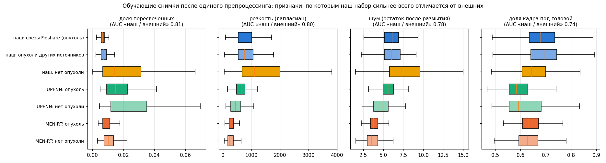

# Узнается ли набор по виду снимка после единого препроцессинга

`python -m src.check_source_probe`. Только обучающая часть этапа 3 (наш train + внешний train), снимок в том виде, в каком он идет в модель (256×256 после `preprocess`), и после одной случайной аугментации обучения. Простая модель (градиентный бустинг) по 15 техническим признакам, 5 фолдов по пациентам. Толкование AUC (записано до запуска): ≥ 0,9 — узнается легко; 0,7–0,9 — частично; < 0,7 — почти не узнается. Проба показывает, что различие есть в простых признаках; что им пользуется нейросеть, она не доказывает.

Снимков: наш: срезы Figshare (опухоль) 2229, наш: опухоли других источников 400, наш: нет опухоли 246, UPENN: опухоль 993, UPENN: нет опухоли 856, MEN-RT: опухоль 567, MEN-RT: нет опухоли 754.

| задача | как идет в модель | после аугментаций |
|---|---|---|
| набор: наш набор против остальных, AUC | 0.991 (легко) | 0.882 (частично) |
| набор: UPENN-GBM против остальных, AUC | 0.991 (легко) | 0.860 (частично) |
| набор: BraTS-MEN-RT против остальных, AUC | 0.987 (легко) | 0.815 (частично) |
| набор из трех, сбалансированная точность (случайно — 0,333) | 0.933 | 0.655 |
| «опухоль есть / нет», все обучающие снимки, AUC | 0.872 | 0.731 |
| «опухоль есть / нет» внутри набора наш набор, AUC | 0.952 | 0.779 |
| «опухоль есть / нет» внутри набора UPENN-GBM, AUC | 0.777 | 0.672 |
| «опухоль есть / нет» внутри набора BraTS-MEN-RT, AUC | 0.682 | 0.568 |

Какой набор угадывает модель (строки — настоящий, столбцы — ответ; как идет в модель):

| | наш | UPENN-GBM | BraTS-MEN-RT |
|---|---|---|---|
| наш набор | 2753 | 40 | 82 |
| UPENN-GBM | 48 | 1727 | 74 |
| BraTS-MEN-RT | 70 | 52 | 1199 |

Отдельные признаки: AUC «наш набор / внешние» (как идет в модель → после аугментаций):

- доля пересвеченных: 0.810 → 0.638
- резкость (лапласиан): 0.798 → 0.579
- шум (остаток после размытия): 0.780 → 0.578
- доля кадра под головой: 0.738 → 0.587
- 90-й перцентиль яркости: 0.689 → 0.634
- средняя яркость головы: 0.685 → 0.573
- энтропия гистограммы: 0.675 → 0.559
- пропорции рамки головы: 0.670 → 0.632
- разброс яркости: 0.670 → 0.642
- заполненность рамки головы: 0.632 → 0.549
- 10-й перцентиль яркости: 0.616 → 0.540
- медиана яркости: 0.608 → 0.514
- блочность JPEG (8×8): 0.541 → 0.502
- доля темных внутри рамки головы: 0.529 → 0.534
- число уровней серого: 0.501 → 0.541

Медианы признаков по группам (как идет в модель):

| признак | наш: срезы Figshare (опухоль) | наш: опухоли других источников | наш: нет опухоли | UPENN: опухоль | UPENN: нет опухоли | MEN-RT: опухоль | MEN-RT: нет опухоли |
|---|---|---|---|---|---|---|---|
| средняя яркость головы | 0.348 | 0.358 | 0.378 | 0.383 | 0.396 | 0.353 | 0.375 |
| разброс яркости | 0.179 | 0.188 | 0.212 | 0.194 | 0.205 | 0.187 | 0.197 |
| 10-й перцентиль яркости | 0.125 | 0.118 | 0.094 | 0.145 | 0.137 | 0.125 | 0.133 |
| медиана яркости | 0.341 | 0.349 | 0.361 | 0.361 | 0.373 | 0.333 | 0.349 |
| 90-й перцентиль яркости | 0.58 | 0.606 | 0.625 | 0.651 | 0.69 | 0.6 | 0.651 |
| доля пересвеченных | 0.007 | 0.007 | 0.014 | 0.015 | 0.02 | 0.009 | 0.01 |
| доля темных внутри рамки головы | 0.24 | 0.224 | 0.266 | 0.245 | 0.244 | 0.249 | 0.233 |
| число уровней серого | 250 | 250 | 250 | 250 | 250 | 250 | 250 |
| энтропия гистограммы | 7.249 | 7.308 | 7.397 | 7.384 | 7.441 | 7.309 | 7.398 |
| резкость (лапласиан) | 769.404 | 753.731 | 1101.96 | 633.778 | 447.16 | 280.345 | 241.577 |
| шум (остаток после размытия) | 6.099 | 6.04 | 7.305 | 5.697 | 4.838 | 3.801 | 3.543 |
| блочность JPEG (8×8) | 1.003 | 1.003 | 1.008 | 1.004 | 1.008 | 1.011 | 1.01 |
| доля кадра под головой | 0.678 | 0.693 | 0.644 | 0.584 | 0.592 | 0.634 | 0.627 |
| пропорции рамки головы | 0.899 | 0.882 | 0.841 | 1.111 | 0.992 | 0.984 | 0.904 |
| заполненность рамки головы | 0.793 | 0.81 | 0.776 | 0.772 | 0.774 | 0.767 | 0.78 |

